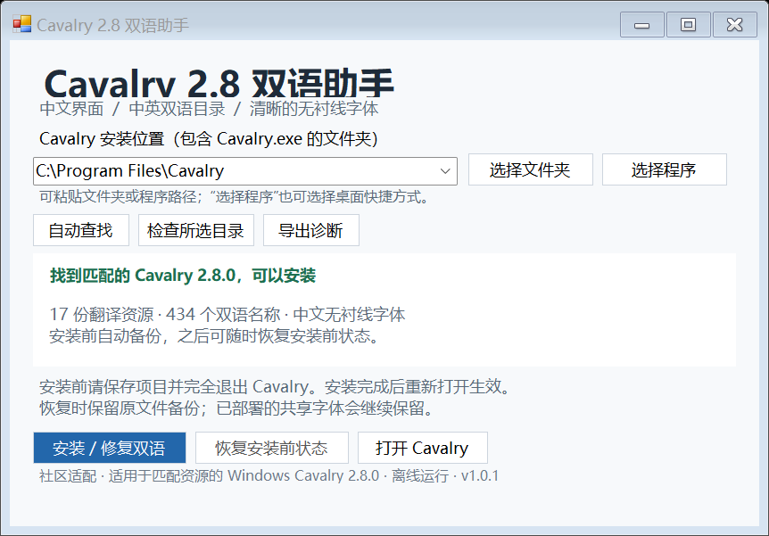

# Cavalry 2.8 中英双语适配技术记录

记录 Windows Cavalry 2.8.0 的个人双语适配实践，包括语言资源兼容、双语目录名称、中文字体、安装位置发现，以及备份恢复流程。

维护者：[ko1btt](https://github.com/ko1btt)  
文档整理日期：2026-10-18  
适配目标：匹配资源结构的 Windows x64 Cavalry 2.8.0  
当前实现版本：v1.0.1（测试阶段）

## 本次适配的主要内容

| 方向 | 已完成的工作 |
| --- | --- |
| 中文界面 | 整理 17 份语言资源，其中 8,554 处显示文本与原版英文不同 |
| 双语目录 | 434 条目录名称记录采用中英并列；公开去重后的 432 条词库 |
| 补充翻译 | 在初版基础上增加 616 处翻译，涵盖 2.8 新内容及之前遗漏的内容 |
| 中文字体 | 为 Windows 界面采用 Noto Sans SC 无衬线字体 |
| 路径识别 | 增加目录、程序、快捷方式与运行位置等发现方式 |
| 备份与恢复 | 集成原版资源校验、首次备份保护、修复与恢复流程 |

以上数字统计显示文本位置和目录名称，不代表对应数量的独立功能，也不表示软件所有文字均已完成翻译。

## 双语目录：中文便于理解，英文便于对照

目录名称同时保留中文和完整英文，便于对照英文教程、查找功能与交流术语。下面直接展示维护者提供的两张原始长图，点击可查看原图。

<table>
<tr><th>行为、变形器等目录</th><th>滤镜目录</th></tr>
<tr><td valign="top"></td><td valign="top"></td></tr>
</table>

长图保留当前真实状态；部分条目仍为英文，具体说明见[目录与检索展示](docs/BILINGUAL_SEARCH.md)。

## 中文与英文关键词检索

在同一搜索界面中，中文关键词“网格”“颜色”和英文关键词 `shape` 均已有真实结果截图。结果以双语名称、类型标签与中文说明呈现，既能按熟悉的中文查找，也便于跟着英文教程定位名称。

<table>
<tr><th>中文：网格</th><th>英文：shape</th></tr>
<tr><td valign="top"></td><td valign="top"></td></tr>
</table>

“网格”结果中同时出现 Grid Layout 与 Mesh 类名称；`shape` 结果中可以看到 JavaScript Shape、Editable Shape 等。更多结果、颜色搜索和截图解析见[中英检索详解](docs/BILINGUAL_SEARCH.md)。目前这些是具体查询示例，不等同于每一组中英同义词或所有搜索入口的完整测试。

## 公开的目录词库

现已分享完整目录名称记录：**434 条原始记录，去重后 432 条唯一词条**。“颗粒 Grain”和“高斯模糊 Gaussian Blur”在原表中各重复一次，原表仍完整保留。

- [浏览完整中英对照表](glossary/NODE_NAMES.md)。
- [CSV：用表格软件整理](glossary/node-names.csv)。
- [JSON：用于翻译协作与项目对接](glossary/node-names.json)。
- [原始 434 条记录](glossary/node-names-source.json)及[字段、来源与共享说明](glossary/README.md)。

这里公开的是目录名称数据，安装器、部署文件及完整界面文本对照继续独立管理。

## 文档导航

- [双语目录与中英检索展示](docs/BILINGUAL_SEARCH.md)
- [公开目录词库](glossary/README.md)
- [遇到的问题与处理思路](docs/PROBLEMS_AND_APPROACHES.md)
- [双语术语示例](docs/TERMINOLOGY_EXAMPLES.md)
- [兼容范围与验证记录](docs/VALIDATION.md)
- [开发过程与版本记录](docs/DEVELOPMENT_RECORD.md)
- [来源与鸣谢](ACKNOWLEDGEMENTS.md)
- [项目范围与许可说明](NOTICE.md)

## 当前进展

v1.0.1 已完成 32 项隔离功能测试，字体内存加载和安装器界面布局已检查。维护者已提供实际菜单和“网格”“shape”“颜色”的检索截图；跨电脑完整安装、更多搜索入口与词条的验收仍在收集。

本仓库围绕技术记录、术语讨论与兼容性反馈维护。反馈问题时，请说明版本、复现步骤和实际结果。
