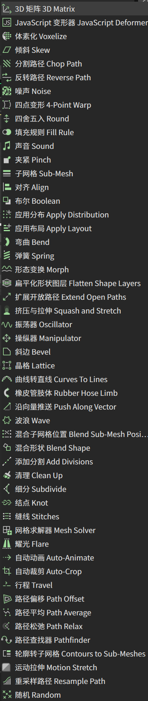
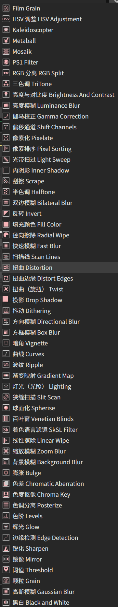
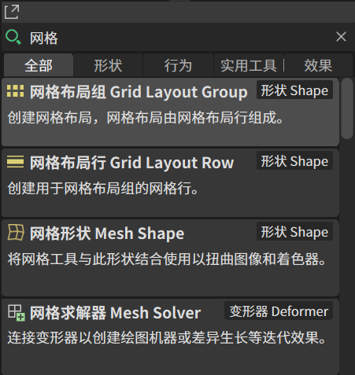
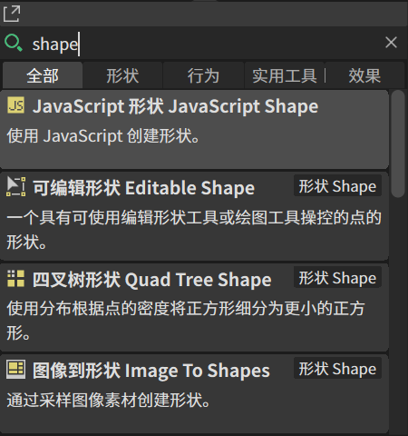
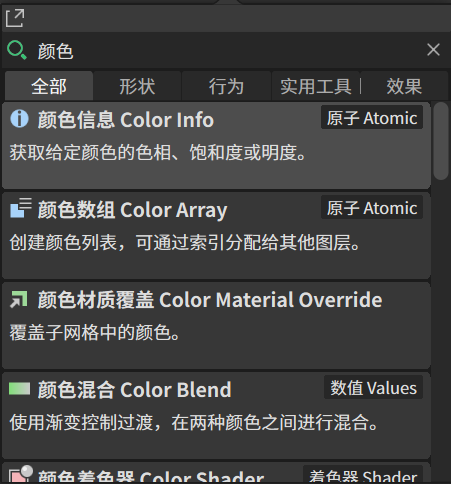

# 双语目录与中英检索展示

本页采用维护者提供的真实 Cavalry 界面截图。为了让文字容易辨认，目录部分选用两张原始长图；搜索部分分别展示“网格”“shape”“颜色”。截图保持原始内容，没有重绘或替换结果文字。

## 中文理解与英文教程对照

双语名称同时保留中文表达和完整英文。例如“形态变换 Morph”“网格求解器 Mesh Solver”“曲线 Curves”。阅读中文界面时仍能对照英文教程中的名称，讨论术语和查找官方资料也更方便。

显示名称与内部标识分开处理：翻译用于阅读和检索，内部类型标识保留原值。完整目录词库已提供[在线表、CSV 与 JSON](../glossary/README.md)。

## 行为、变形器与滤镜长图

<table>
<tr><th>行为与变形器等名称</th><th>滤镜目录名称</th></tr>
<tr><td valign="top"></td><td valign="top"></td></tr>
</table>

左图可见噪声 Noise、弯曲 Bend、弹簧 Spring、形态变换 Morph、晶格 Lattice、网格求解器 Mesh Solver 等名称；右图可见双边模糊 Bilateral Blur、扭曲（旋扭） Twist、曲线 Curves、波纹 Ripple、灯光（光照） Lighting 等名称。

这些图片展示当前目录状态，并不是每个效果的功能演示。右图顶部仍有 Film Grain、Kaleidoscopter、Metaball、Mosaik、PS1 Filter 等仅显示英文的条目，它们的来源和可汉化范围仍待核对，不据此宣称所有扩展内容都已完成翻译。

## 示例一：输入中文“网格”

截图中的搜索框输入“网格”，结果包括：

- 网格布局组 Grid Layout Group。
- 网格布局行 Grid Layout Row。
- 网格形状 Mesh Shape。
- 网格求解器 Mesh Solver。

同一个中文词能对应不同英文概念：Grid 在这里涉及布局，Mesh 涉及网格形状或求解。结果保留完整英文名称、类型标签和中文说明，有助于判断当前要找的是布局、形状，还是变形器。

## 示例二：输入英文“shape”

截图输入英文 `shape`，仍返回带中文与英文名称的条目，包括 JavaScript 形状 JavaScript Shape、可编辑形状 Editable Shape、四叉树形状 Quad Tree Shape，以及图像到形状 Image To Shapes。

因此，学习英文教程时可以继续用英文名称的一部分查找；找到结果后，又能借助中文名称和说明理解候选项。这里展示的是截图中的英文小写查询，不将其扩展解释为所有搜索入口的完整大小写或模糊匹配测试。

## 示例三：输入中文“颜色”

截图可见颜色信息 Color Info、颜色数组 Color Array、颜色材质覆盖 Color Material Override、颜色混合 Color Blend 等结果，卡片还显示类别和中文说明。

搜索结果能把名称、用途说明和所属类型放在一起对照。颜色信息、数组、材质覆盖和颜色混合的用途不同，不能只因为同含“颜色”二字就视为相同功能。

## 当前证据说明

这些截图已展示中文关键词“网格”“颜色”和英文关键词 `shape` 在当前界面中都能返回相应结果。它们支持“当前中英文检索示例可用”的描述。

三张截图不是同一个概念的中英配对测试，也没有遍历全部 432 个唯一词条、所有搜索入口或其他电脑。因此不宣称每一组中英同义词会返回完全相同的集合，也不把截图当作全部兼容性验收。其余验证范围见[验证记录](VALIDATION.md)。
